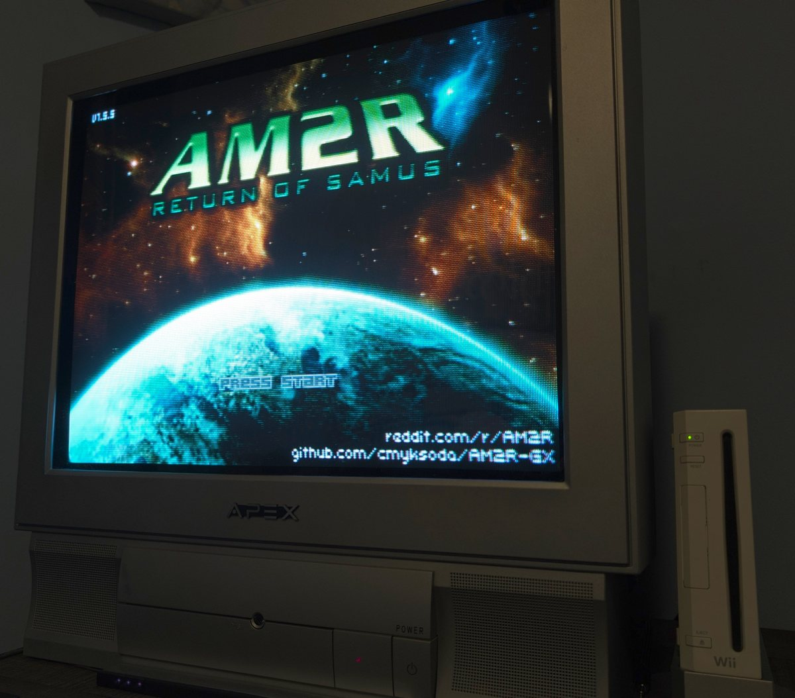

# AM2R GX

**AM2R 1.5.5 on the Wii**, as a Homebrew Channel app.

AM2R (Another Metroid 2 Remake) is Milton "DoctorM64" Guasti's GameMaker game; the 1.5.5 Community Update is the AM2R Community Developers' work. AM2R GX runs the game's own bytecode on the console through [Butterscotch](https://github.com/ButterscotchRunner/Butterscotch), an open-source GameMaker: Studio runner, with a native **GX** renderer, a texture repacker and an audio path written for the Wii.

This repository and its releases never contain music, sprites or any Nintendo, DoctorM64 or Community assets (apart from the AM2R logo used as `icon.png`); the console builds 1.5.5 from *your supplied copy of AM2R 1.1* on first boot.

Not affiliated with Nintendo, YoYo Games, Milton Guasti or the AM2R Community Developers.

## What you need

- A Wii (or a Wii U in Wii mode) with the Homebrew Channel, and an SD card or a FAT32 USB drive.
- A GameCube controller, Wii Remote with Nunchuk, or a Classic Controller.
- The original **AM2R 1.1** release zip (use a search engine to find this!).

## Install

1. Copy the release's `apps/` folder onto the SD card/USB drive.
2. Put `AM2R_11.zip` in `/apps/am2r/`, next to `boot.dol` and `patch/`.
3. Launch **AM2R GX** from the Homebrew Channel.

The first boot unpacks the zip, applies the 1.5.5 delta, repacks the textures into a Wii-friendly format, and copies the loose 1.5.5 files. It shows its progress on screen and *takes about four minutes*; the result is `/apps/am2r/game/`. Every later boot goes straight to the title. The zip and `patch/` can be deleted afterwards. If something goes wrong the screen says so and `/apps/am2r/profile.txt` holds the details.

Saves live in `/apps/am2r/save/` in the game's own format.

## Controls

By default, missiles work in **Hold** style: hold Arm Weapon to use the selected weapon, let go to return to the beam. Aiming uses **one** diagonal button: hold it, and Up or Down picks the diagonal. Both can be changed in Options → Controls, and every button can be remapped there.

| Action | Classic Controller | GameCube Controller | Wii Remote + Nunchuk |
|---|---|---|---|
| Move | stick or d-pad | stick or d-pad | Nunchuk stick |
| Jump | B | A | A |
| Fire (hold to charge; bombs in ball) | Y | B | B trigger |
| Morph | A | X | C |
| Weapon Select | X or − | Y | − |
| Aim Diagonal (hold) | L | L | d-pad ↑ / ↓ (up / down diagonal) |
| Arm Weapon (hold) | R or ZR | R | Z |
| Aim Lock | ZL | Z | d-pad ← or → |
| Map / pause | + | Start | + |

Hold **HOME** for a second (Wii Remote or Classic Controller), or **X + B + Start** on a GameCube controller, to return to the Homebrew Channel. **Exit Game** on the title menu does the same.

## Picture

- The console's own screen setting (Wii Settings → Screen → 4:3 or 16:9) picks the video mode. The game's own Options → Display → Widescreen toggle still decides whether the game draws a 16:9 picture on a widescreen display. With it toggled off, you get pillarboxed 4:3.
- **240p** (Options → Display, where the PC version has VSync) draws each of the game's 240 lines once, for CRT TVs that show 240p sharply.
- **Resize/Move Screen** (Options → Display): if your TV cuts the edges, the d-pad pulls the picture in from the sides and the top/bottom, and **A** held with the d-pad moves the whole picture. **B** closes it.
- **HUD Margins** (Options → Display): moves the HUD, the corner prompts and the notification box in from the sides and the top/bottom, one game pixel at a time, while the world keeps its sharp 2× pixels. The default keeps them 11 pixels from the top and bottom (typical safe area for overscanning televisions); a TV that shows the whole picture can bring them back out to the edges. **B** closes it.
- Both are saved per console (`overscan-<console id>.txt` in `/apps/am2r/`, with `overscan.txt` as a shared fallback: `h v [viWidth] [up/down shift] [sideways shift] [HUD sides] [HUD top/bottom]`).

## How it runs

Almost everything runs at a clean 60 fps on a Wii, with the two heaviest rooms of the game (a5h04 and a2h02) holding at a steady 30. Music streams from the card on its own thread and all of 1.5.5's sounds play. Texture pages load from the card in the background before they are needed (Samus's suit, the HUD, the pause screen, a room's metroid, the credits); a page the game reaches unexpectedly still loads on the spot after a brief stutter.

**Randomizer seeds:** a custom seed gives the same item layout every time, on every Wii. It is *almost certainly* not the same layout the PC version gives for that seed, because the Wii build seeds its random numbers differently from GameMaker.

## License and credits

The runner source here is **GNU Affero GPL v3.0** (see [LICENSE](LICENSE)); combined with Butterscotch (AGPL-3.0) the `.dol` is AGPL. The game and its assets stay whatever copy of AM2R you supply.

- AM2R by Milton "DoctorM64" Guasti; the 1.5.5 Community Update by the AM2R Community Developers.
- [Butterscotch](https://github.com/ButterscotchRunner/Butterscotch), the GameMaker: Studio runner this port is built on.
- [devkitPro](https://devkitpro.org/): devkitPPC, libogc, libfat, wiiuse and the portlibs.
- xdelta3 (Joshua MacDonald, Apache-2.0) as the on-console delta decoder; stb (Sean Barrett) for image decoding.

---

*This project was made with AI assistance. For more information, see [my AI usage statement](https://github.com/cmyksoda/cmyksoda/blob/main/AI_USAGE.md).*