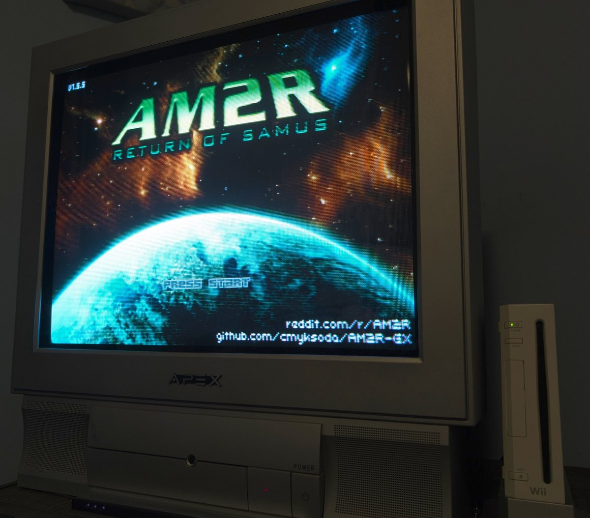

# AM2R GX

***AM2R (Another Metroid 2 Remake) 1.5.5 on the Wii!***

## What you need

- A Wii (or a Wii U in Wii mode) with the Homebrew Channel, and an SD card or a FAT32 USB drive.
- A GameCube controller, Wii Remote with Nunchuk, or a Classic Controller. A GameCube controller adapter also works on a Wii U in Wii mode, and a DualShock 3 or 4 on a USB cable is experimental and untested; see Controls.
- The original **AM2R 1.1** release zip (use a search engine to find this!)

## Install

1. Copy the release's `apps/` folder onto the SD card/USB drive.
2. Put `AM2R_11.zip` in `/apps/am2r/`, next to `boot.dol` and `patch/`.
3. Launch **AM2R GX** from the Homebrew Channel.

The first boot unpacks the zip, applies the 1.5.5 updates, repacks the textures into a Wii-friendly format, and copies the loose 1.5.5 files. It shows its progress on screen and *takes about four minutes*.

Every later boot goes straight to the title. The zip and `patch/` can be deleted afterwards. If something goes wrong the screen says so and `/apps/am2r/profile.txt` holds the details.

Saves live in `/apps/am2r/save/` in the game's own format.

## Controls

By default, missiles work in **Hold** style: hold Arm Weapon to use the selected weapon, let go to return to the beam. Aiming uses **one** diagonal button: hold it, and Up or Down picks the diagonal. Both can be changed in Options → Controls, and every button can be remapped there.

**Default Controls:**
| Action | Classic Controller | GameCube Controller | Wii Remote + Nunchuk | DualShock 3 or 4 (experimental) |
|---|---|---|---|---|
| Move | stick or d-pad | stick or d-pad | Nunchuk stick | left stick or d-pad |
| Jump | B | A | B trigger | Cross |
| Fire (hold to charge; bombs in ball) | Y | B | A | Square |
| Morph | A | X | C | Circle |
| Weapon Select | X | Y | − | Triangle |
| Aim Diagonal (hold) | L | L | d-pad ↑ / ↓ (up / down diagonal) | L1 |
| Arm Weapon (hold) | R | R | Z | R1 |
| Aim Lock | ZL | Z | d-pad ← or → | L2 |
| Map / pause | + | Start | + | Start (DS4: Options) |

Hold **HOME** for a second (Wii Remote or Classic Controller), **PS** on a DualShock, or **X + B + Start** on a GameCube controller, to return to the Homebrew Channel. **Exit Game** on the title menu does the same.

- **GameCube controller adapter** (Wii U in Wii mode): Nintendo's WUP-028 or a clone switched to Wii U mode. Plug the controller into port 1, and the adapter's gray power cable too for rumble.
- **DualShock 3 or 4** (experimental, untested on hardware): USB cable only. It plays as a Classic Controller with PlayStation button prompts, rumble, and the defaults in the table above. On a DualShock 4, Share and Options work as Select and Start, and the prompts call them that. If you try one, please report on the [issues page](https://github.com/cmyksoda/AM2R-GX/issues) with `/apps/am2r/profile.txt` attached.

## Picture

- The console's own screen setting (Wii Settings → Screen → 4:3 or 16:9) picks the video mode. On a widescreen display, one has the ability to toggle widescreen off. With it toggled off, you get pillarboxed 4:3.
- **240p** draws each of the game's 240 lines once, for CRT TVs that show 240p sharply.
- **Scanlines** (Options → Display, right under Widescreen): Left/Right to choose between Disabled, 100%, 75%, 50% and 25%. At 100%, every other line is black, which on a 480p CRT gives the look of 240p on a high-end CRT. The lower values darken the lines less. Only available in 480p.
- **Resize/Move Screen** (Options → Display): if your TV cuts the edges, the d-pad pulls the picture in from the sides and the top/bottom, and **A** held with the d-pad moves the whole picture. **B** closes it.
- **HUD Margins** (Options → Display): moves the HUD, the corner prompts and the notification box in from the sides and the top/bottom, one game pixel at a time, while the world keeps its sharp 2× pixels. The default keeps them 11 pixels from the top and bottom (typical safe area for overscanning televisions); a TV that shows the whole picture can bring them back out to the edges. **B** closes it.
- Resize/Move Screen, HUD Margins and Scanlines are saved per console (`overscan-<console id>.txt` in `/apps/am2r/`, with `overscan.txt` as a shared fallback: `h v [viWidth] [up/down shift] [sideways shift] [HUD sides] [HUD top/bottom] [scanlines, 0 for Disabled, then 1 to 4 for 25% to 100%]`).

## Note on randomizer

**Randomizer seeds:** a custom seed gives the same item layout every time, on every Wii. It is *almost certainly* not the same layout the PC version gives for that seed, because the Wii build seeds its random numbers differently from GameMaker.

## Credits

- **AM2R** by Milton "DoctorM64" Guasti, the game this port is for, with its 1.5.5 Community Update by the AM2R Community Developers
- **Butterscotch**, the GameMaker: Studio runner this port is built on, at [ButterscotchRunner/Butterscotch](https://github.com/ButterscotchRunner/Butterscotch)
- **devkitPPC**, **libogc**, **libfat**, **aesnd**, and the portlibs by [devkitPro](https://devkitpro.org/)
- **wiiuse** by Michael Laforest, for the Wii Remote, as included in libogc
- **libwiiinput** from [quatric](https://github.com/quatric/libwiiinput), which holds the GameCube controller adapter driver
- **embedded-game-controller** (MIT), whose DualShock 3 and 4 drivers were the reference for this port's DualShock reader
- **xdelta3** by Joshua MacDonald (Apache License 2.0), the on-console delta decoder
- **stb** by Sean Barrett and contributors, for image decoding
- **FreeType** by the FreeType Project, which draws the game's fonts
- **zlib** by Jean-loup Gailly and Mark Adler, for unpacking zip files and PNG images

The full list, with every library and its license, is in [NOTICE](NOTICE).

## License

The runner source here is free software under the [GNU Affero General Public License, version 3](LICENSE); combined with Butterscotch (AGPL version 3), the `.dol` is AGPL. Some parts use other licenses: xdelta3 is under the Apache License 2.0 ([`wii/src/xdelta3/LICENSE`](wii/src/xdelta3/LICENSE)), and the libraries in the `.dol` keep their own licenses, which [NOTICE](NOTICE) lists. The files in `wii/src/libwiiinput/`, and the `lwi_*.c` files that compile them, are GPL-3.0-or-later. The game and its assets stay whatever copy of AM2R you supply.

This repository and its releases never contain music, sprites or any Nintendo, DoctorM64 or Community assets (apart from the AM2R logo used as `icon.png`, and the Community's GPL v3 1.5.5 patch data in `patch/`); the console builds 1.5.5 from *your supplied copy of AM2R 1.1* on first boot.

Not affiliated with Nintendo, YoYo Games, Milton Guasti or the AM2R Community Developers.

---

*This project was made with AI assistance. For more information, see [my AI usage statement](https://github.com/cmyksoda/cmyksoda/blob/main/AI_USAGE.md).*
